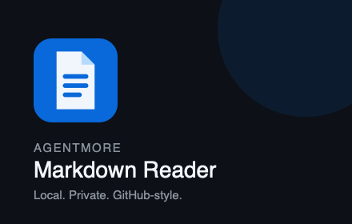

# AgentMore Markdown Reader

[](https://github.com/agentmore/markdown-reader/actions/workflows/ci.yml)
[](LICENSE)
[](manifest.ts)

> A fast, private, GitHub-style reader for local and remote Markdown files.



Markdown Reader turns raw `.md` and `.markdown` files into a polished reading view in Chrome, Brave, and other Chromium browsers. Rendering stays entirely on-device: documents are never sent to AgentMore or a third-party rendering API.

## Highlights

- GitHub Flavored Markdown tables, task lists, autolinks, and strikethrough
- Readable nested YAML frontmatter for skill files
- Syntax-highlighted code with an always-visible copy button
- Source-faithful Preview and Raw modes
- Open, copy, download, theme, and recent-document controls
- GitHub-matched 1,012px reading canvas with responsive wrapping
- Flash-free startup at `document_start`
- Local-only history for the 30 most recently viewed Markdown files

## Install from source

Requirements: Node.js 22.12 or newer and npm.

```bash
git clone https://github.com/agentmore/markdown-reader.git
cd markdown-reader
npm ci
npm run build
```

Then:

1. Open `chrome://extensions` or `brave://extensions`.
2. Enable **Developer mode**.
3. Choose **Load unpacked** and select the generated `dist` directory.
4. Open the extension's details and enable **Allow access to file URLs**.
5. Open a local or remote `.md` or `.markdown` file.

Try it with [`https://agentmore.app/skill.md`](https://agentmore.app/skill.md).

## Privacy by design

Markdown is parsed and rendered locally. The original source remains unchanged and is used for Raw mode, copying, and downloads. The extension stores only the theme preference and up to 30 recent Markdown URLs, filenames, and timestamps in Chrome's local extension storage.

There is no analytics, advertising, tracking, account system, document upload, or remote code. See the full [privacy policy](store/PRIVACY.md).

## Rendering behavior

The renderer uses CommonMark plus the formal GFM extensions. GitHub adds proprietary server-side processing around GFM, but using GitHub's Markdown API would transmit local documents and introduce network requirements. This project stays private and offline by default.

A content-type gate ensures ordinary HTML pages—including GitHub repository pages whose routes end in `.md`—remain untouched.

## Development

```bash
npm test          # Run the test suite once
npm run build     # Type-check and create the production extension
npm run dev       # Start Vite in development mode
```

Use [`fixtures/postiz-sample.md`](fixtures/postiz-sample.md) to exercise frontmatter, tables, code blocks, inline code, links, task lists, and blockquotes.

## Project structure

```text
src/                  Viewer, renderer, popup, history, and tests
public/icons/         Browser and store icons
fixtures/             Markdown fixtures for manual QA
store/                Store listing, privacy, and release materials
manifest.ts           Manifest V3 definition
vite.config.ts        Extension build configuration
```

## Contributing

Issues and pull requests are welcome. Read [CONTRIBUTING.md](CONTRIBUTING.md) before submitting a change, and report vulnerabilities according to [SECURITY.md](SECURITY.md).

## License

Released under the [MIT License](LICENSE) by [AgentMore](https://agentmore.app).
